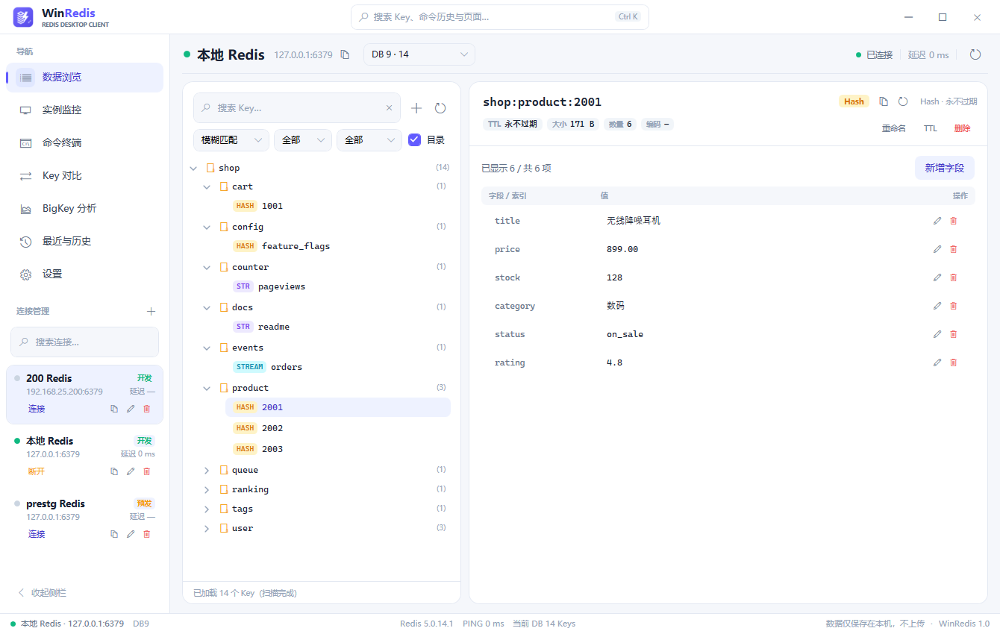

# WinRedis · 现代化 Redis 桌面客户端

[English](README.en.md) | 简体中文

本地优先的 Windows Redis 桌面客户端：现代化 WPF 界面、真实 Redis 数据、默认安全（默认 `SCAN`、默认本地搜索、高危操作二次确认、密码 DPAPI 加密）。支持中文 / English 界面（默认中文，可在设置中切换并重启生效）。



## 功能

- **连接管理**：新建 / 编辑 / 测试 / 连接 / 断开 / 删除；分组目录（折叠展开、拖拽移动、右键快速移动、预置分组）、警告色标记、环境标签、复制脱敏配置
- **数据浏览**：DB 切换（下拉预览各库 Key 数量）、SCAN 分批加载、本地模糊 / 全匹配 / 数据库模糊（性能二次确认）、类型与 TTL 筛选、目录树视图（记住展开状态）
- **六种类型编辑器**：String（UTF-8/GBK 自动解码、超长换行/横向滚动条、JSON 格式化）、Hash、List、Set、ZSet、Stream（分页浏览与元素级写入）
- **监控**：内存、QPS、连接数、命中率、命令统计 TOP 10、SlowLog 采样
- **命令终端**：L0–L3 风险分级、生产环境与高危命令二次确认、只读连接拦截、命令历史
- **Key 对比**：两个只读会话对比 String / Hash / List / Set / ZSet 差异并导出
- **BigKey 分析**：SCAN + MEMORY USAGE 识别大 Key，支持 CSV 导出与右侧预览
- **全局搜索（Ctrl+K）**：页面跳转、最近访问与命令历史
- **外观**：8 套主题（浅色 / 深色 / 跟随系统 / 海盐 / 奶糖 / 森林 / 繁花 / 微风）、全局字体大小、中英文界面
- **关闭行为**：关闭主窗口时可选择最小化到系统托盘（后台继续运行，托盘图标恢复）或直接退出，可记住选择并在设置中修改
- **本地数据**：连接 `connections.json`、设置 `settings.json`、历史 `history.json`，全部保存在 `%AppData%\WinRedis`，不上传任何外部服务

## 安全设计

- 密码经 Windows DPAPI 加密落盘；复制 / 导出连接配置默认不含任何密码或 SSH 凭据
- 默认使用 `SCAN` 迭代，绝不使用 `KEYS *`
- 删除、批量、`FLUSHDB` / `FLUSHALL` / `CONFIG SET` / `SHUTDOWN` 等在执行层二次确认；L3 命令需手动输入命令名
- 生产环境可开启全部写操作确认；只读连接阻止一切写命令
- 数据库模糊搜索默认关闭，启用前弹窗提示性能影响

## 开发与构建

环境：Windows 10/11、.NET SDK 10。

```powershell
# 构建
dotnet build WinRedisClient.slnx -c Release

# 测试（单元 + 集成 + 性能 + Redis 测试）
dotnet test WinRedisClient.slnx -c Release

# 本地运行
dotnet run --project src/WinRedisClient.App/WinRedisClient.App.csproj
```

### 发布单文件 exe

```powershell
dotnet publish src/WinRedisClient.App/WinRedisClient.App.csproj -c Release -r win-x64 `
  --self-contained true -p:PublishSingleFile=true `
  -p:EnableCompressionInSingleFile=true `
  -p:IncludeNativeLibrariesForSelfExtract=true `
  -o publish/win-x64
```

输出：`publish/win-x64/WinRedisClient.exe`（约 70 MB，包含 .NET 运行时，无需安装）。

### 制作安装包

见 [docs/安装包制作.md](docs/安装包制作.md)（Inno Setup 脚本位于 `tools/installer/WinRedis.iss`）。

## 项目结构

```
src/
  WinRedisClient.App            WPF 界面（视图、对话框、主题、图标）
  WinRedisClient.Presentation   视图模型与展示逻辑（无 WPF 依赖）
  WinRedisClient.Core           模型、抽象与服务（本地化、TTL、Diff 等）
  WinRedisClient.Redis          StackExchange.Redis 实现
  WinRedisClient.Transport      SSH 隧道（SSH.NET）
  WinRedisClient.Infrastructure JSON 持久化（DPAPI 加密）
tests/                          单元、集成、性能与 Redis 测试
docs/                           交付清单与运行截图
tools/                          品牌资源、本地化与安装包脚本
```

## 界面语言

界面文案通过 `Loc.T("中文原文")` / `{loc:Tr '中文原文'}` 获取，英文翻译位于 `src/WinRedisClient.Core/Localization/en.json`，以中文原文为键；缺失翻译自动回退中文。切换语言：设置 → 外观 → 界面语言，保存后重启生效。

## 许可

本项目采用 [MIT License](LICENSE)。

第三方组件：[StackExchange.Redis](https://github.com/StackExchange/StackExchange.Redis)（MIT）、[SSH.NET](https://github.com/sshnet/SSH.NET)（MIT）、[CommunityToolkit.Mvvm](https://github.com/CommunityToolkit/dotnet)（MIT）、[Microsoft.Extensions.Logging](https://github.com/dotnet/runtime)（MIT）。

## 免责声明

WinRedis 直接对真实 Redis 实例执行命令。请务必在生产环境使用前确认二次确认与只读设置符合你的安全要求；因误操作造成的数据变更由操作者自行承担。
